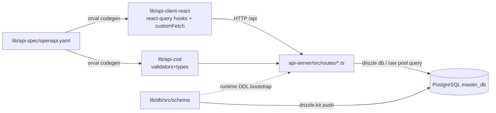

# Repository Guidelines

## Project Overview

Inventory management webapp ("Gudang Pemaron") for PT PLN — tracks MCB (Miniature Circuit Breaker) materials with QR/barcode scanning, stock in/out, used-material classification (garansi vs usul hapus), plus cash ledger (Kas Gudang), employee overtime/attendance (Lembur/Absensi with GPS geofence + selfie), and OCR parsing of receipt photos (client-side tesseract.js). UI text is Indonesian. Replit-originated monorepo; production runs on a Termux-based LAN server at `https://app.gudangpemaron.my.id`.

Stack: pnpm workspaces · TypeScript 5.9 · React 19.1 + Vite 7 + Tailwind v4 + shadcn/ui + wouter + TanStack Query · Express 5 + pino · PostgreSQL + Drizzle ORM · Orval codegen · esbuild (API bundle).

## Architecture & Data Flow

Contract-first for **spec endpoints only**; most newer endpoints bypass the contract entirely.

- **API boot** (`artifacts/api-server/src/app.ts`): `pinoHttp → cors → express.json({limit:"500mb"}) → app.use("/api", router)`. Also serves the built frontend from `../../gudang/dist/public` with SPA catch-all `app.get("/{*path}")` (Express 5 wildcard syntax), so production is one process on `PORT` (8080).
- **Router aggregation**: `routes/index.ts` mounts 14 feature routers bare (`router.use(xRouter)`); each route file carries its own full path prefix (`router.get("/kas/transaksi", ...)`).
- **Two DB access paths, chosen per route**: spec CRUD uses drizzle builder (`db.select()/insert().returning()/transaction()`); reports/aggregates/restore use raw parameterized `pool.query` with `conds: string[]`/`args: any[]` fragments. `backup_config`/`spreadsheet_config` have no drizzle schema (raw SQL only).
- **Schema truth is dual**: `lib/db/src/schema/*` (drizzle-kit push, no migrations dir) *and* idempotent raw `CREATE TABLE IF NOT EXISTS` + `ALTER ... ADD COLUMN IF NOT EXISTS` DDL in `app.ts:setupDatabase()`. These drift; changing schema usually means touching both.
- **Auth — NOT JWT**: `generateToken` = base64url of `userId:username:timestamp` (unsigned, never expires; `api-server/src/lib/auth.ts`). Passwords: `SHA256(pw + "gudang_salt_2024")`. Token + `currentUser` JSON live in localStorage; sent as `Authorization: Bearer`. No global auth middleware — guards are copy-pasted local `requireMaster()` helpers; users/kas/lembur endpoints are effectively unauthenticated. Roles: `master`, `user`, `bendahara` (+ client-only `guest`). Seeds: `admin/admin123`, `operator1/user123`.
- **Frontend state**: TanStack Query for server data + plain `useState`/`useEffect`; no redux/zustand. Route gating via `ProtectedRoute({component, roles})` in `gudang/src/router.tsx`; sidebar menus filtered by role + per-user `menuAccess`.

## Key Directories

| Path | Purpose |
|---|---|
| `artifacts/api-server/src/routes/` | One Express router file per feature (14: auth, users, materials, scanIn, scanOut, materialMasuk/Keluar, materialBekas, history, dashboard, backup, sheets, kas, health) |
| `artifacts/api-server/src/lib/` | `auth.ts`, `google-drive.ts`, `google-sheets.ts`, `backup-scheduler.ts`, `logger.ts` |
| `artifacts/gudang/src/pages/` | One kebab-case page file per feature (dashboard, scan/scan-in/scan-out, master, kas-gudang, absensi, material-*, riwayat, backup, login, ...) |
| `artifacts/gudang/src/components/` | `layout.tsx` (sidebar/nav), `ui/*` (~50 shadcn primitives) |
| `artifacts/gudang/src/lib/auth.tsx` | `AuthProvider`/`useAuth` (localStorage token) |
| `lib/db/src/schema/` | Drizzle table defs, one file per entity |
| `lib/api-spec/` | `openapi.yaml` (single source of truth for spec endpoints) + `orval.config.ts` |
| `lib/api-zod/`, `lib/api-client-react/` | **generated** code (`src/generated/`), hand-edited only via codegen + `custom-fetch.ts` |
| `artifacts/mockup-sandbox/` | Design mockups; NOT deployed, excluded from root build/typecheck |
| `scripts/` | Template demo `hello.ts` + `post-merge.sh` (Replit merge hook: install + db push) |

## Development Commands

pnpm only (`preinstall` deletes npm/yarn lockfiles). Requires `DATABASE_URL` (Postgres) and `PORT` for the API; no `.env.example` in repo.

| Task | Command |
|---|---|
| Install | `pnpm install` |
| Typecheck everything | `pnpm run typecheck` (libs via `tsc --build`, then artifacts + scripts; gudang excluded) |
| Rebuild shared libs | `pnpm run typecheck:libs` — run after any `lib/` change, before API typecheck |
| Dev API | `PORT=3001 pnpm --filter @workspace/api-server run dev` (no watch: esbuild rebuild + start) |
| Dev frontend | `pnpm --filter @workspace/gudang run dev` (Vite, `/api` proxy → `localhost:3001`) |
| Push DB schema | `pnpm --filter @workspace/db run push` (or `push-force`) |
| Regenerate API clients/validators | `pnpm --filter @workspace/api-spec run codegen` |
| Build all | `pnpm run build` (typecheck + per-package build; API → `dist/index.mjs`, frontend → `dist/public`) |
| Run API prod-style | `PORT=8080 pnpm --filter @workspace/api-server run start` |

Deploy (current branch `update10`; `updateN` branch chain): commit → `git push origin update10` → pull + build frontend + restart on the Termux/STB server (`replit.md` documents Google Drive/Sheets setup there). CI (`.github/workflows/deploy.yml`, defang) targets `main` (Vercel) and is not the real LAN deployment path.

## Code Conventions & Common Patterns

- **Style**: double quotes, semicolons, 2-space indent, ESM only (all packages `"type":"module"`). TS is selective-strict (`tsconfig.base.json`: strictNullChecks/noImplicitAny on, `strictFunctionTypes:false`).
- **Imports**: workspace packages by name (`@workspace/db`, `@workspace/api-zod`, `@workspace/api-client-react`) — libs export raw TS via `"exports": "./src/index.ts"` + `customConditions:["workspace"]`, so no build step is needed to consume them. Frontend uses `@/` alias (`@/components/ui/card`). `import type {...}` for types. Version pins via pnpm catalog (`catalog:` in package.jsons).
- **Route handlers**: `async (req, res): Promise<void>`; default-export an `IRouter`. Responses: errors `{ error: "..." }` (Indonesian in newer routes), 400 on zod `safeParse` failure, 404 `"... not found"`, 201 on create, 204 via `res.sendStatus(204)`. No centralized error handler.
- **Validation split**: spec routes use orval-generated zod schemas (`<OperationId>Body/QueryParams/Response`, re-`parse()` before `res.json`); newer routes (kas, sheets, materialMasuk/Keluar, materialBekas, backup) hand-validate inline (`typeof`/`Number.isInteger` on `req.body ?? {}`). Match the style of the file you're editing.
- **Frontend API calls, three tiers**: (1) spec endpoints → orval hooks (`useListMaterials`, `useCreateMaterial`) with `queryClient.invalidateQueries({ queryKey: getListMaterialsQueryKey() })`; (2) non-spec endpoints → `customFetch<T>("/api/...")` from `@workspace/api-client-react` (auto-attaches Bearer, throws `ApiError`); (3) kas/absensi pages use raw `fetch` with manual headers. Prefer tier 1 when adding spec endpoints.
- **Naming**: files kebab-case (pages) / camelCase (routes, schema); drizzle tables `pgTable("snake_name", ...)` with camelCase TS fields; exports `xTable`, `insertXSchema`, `InsertX`, `X` (`typeof xTable.$inferSelect`); zod imports as `zod` or from `"zod/v4"`.
- **Domain pattern**: classify by regex on serials — `materialBekas.ts` `parseSN` `/^.{17}(\d{4})/` (MMYY) → year>2021 garansi else usul_hapus; `kas.ts` `haversine()` geofence vs `lembur_lokasi_config.radius` → 403.

## Important Files

- `artifacts/api-server/src/index.ts` — entry, `PORT` required; `src/app.ts` — middleware, static SPA serving, `setupDatabase()` raw DDL + admin seed, starts backup scheduler.
- `artifacts/api-server/src/routes/index.ts` — router aggregation; `src/lib/auth.ts` — token/password scheme.
- `artifacts/api-server/build.mjs` — esbuild config (external list, CJS banner, pino plugin).
- `artifacts/gudang/src/main.tsx` → `App.tsx` (provider nesting) → `router.tsx` (wouter + role gates); `src/lib/auth.tsx`.
- `lib/db/src/index.ts` (+ `drizzle.config.ts`) — `DATABASE_URL` required; exports `pool`, `db`, schema.
- `lib/api-spec/openapi.yaml` + `orval.config.ts`; `lib/api-client-react/src/custom-fetch.ts` (hand-written mutator, `setAuthTokenGetter`).
- `vite.config.ts` (gudang) — proxy/port; root `package.json` scripts; `replit.md` — run/setup docs.

## Gotchas (read before touching contracts)

- Any new param/endpoint must be declared in `openapi.yaml` before codegen — undeclared params get silently dropped.
- Orval name collisions cause TS2308 (hence `LoginResponse` was renamed `AuthResult`); keep the spec title transformer ("Api") intact.
- After schema changes: `pnpm run typecheck:libs` before typechecking consumers; then update both drizzle schema and `app.ts` runtime DDL.
- Printed QR must be a static `` from `qrcode`'s `toDataURL(text,{margin:4})` — never CDN qrcodejs canvas (quiet-zone scan failures).
- `pnpm-workspace.yaml` sets `minimumReleaseAge: 1440` (supply-chain guard) — never disable it.
- Restart the frontend dev process after adding frontend deps (Vite optimize cache).

## Runtime/Tooling Preferences

- **Package manager**: pnpm workspaces (never npm/yarn); versions centralized in `pnpm-workspace.yaml` catalogs — add deps with `catalog:` references where a pin exists.
- **Node**: ≥20 (CI Node 24; Replit nodejs-20 module; STB uses Termux Node). ESM everywhere; API runs as bundled `dist/index.mjs`, libs ship raw TS.
- **React/react-dom pinned exactly `19.1.0`** via catalog — don't bump independently.
- **Required env**: `DATABASE_URL`, `PORT` (API: 3001 dev / 8080 prod); optional: `LOG_LEVEL`, `NODE_ENV`, `BASE_PATH`, `GOOGLE_CLIENT_ID/SECRET/REDIRECT_URI` (Drive scope is full `auth/drive`; Sheets reads range `C9:K1000`, stock col K).
- **DB**: PostgreSQL (Replit-provisioned / `master_db`); schema sync via `drizzle-kit push` only — no migration files, don't invent a migrate workflow.

## Testing & QA

- **No committed test infrastructure** — zero test files, no vitest/jest/playwright/eslint config. Commit messages citing "N/N test" refer to throwaway ad-hoc scripts, not repo tests.
- **The typecheck gate is the CI check**: run `pnpm run typecheck` (and `typecheck:libs` first) — that's what `.github/workflows/deploy.yml` enforces before deploy. Keep it green.
- Verify changes by running the app: start API + `curl http://localhost:<PORT>/api/health` and exercise the changed endpoint; for frontend, `pnpm --filter @workspace/gudang run dev` and use the UI. For parser/regex logic (OCR amount parsing, `parseSN`), write a quick throwaway script against real inputs, run it, then delete it.
- Default logins for smoke: `admin/admin123` (master), `operator1/user123` (user).
